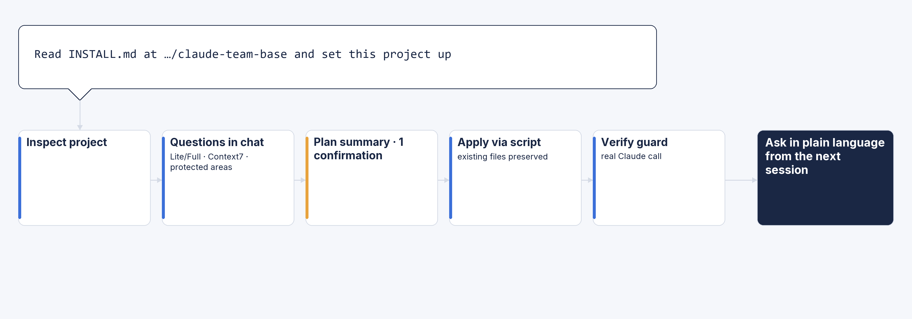

> [!WARNING]
> **Under development · Not ready for use**
> Do not install or apply this to a project before an official release. The guide below describes work in progress.

<p align="center">
  
</p>

<p align="center">
  <a href="https://github.com/jbeat30/claude-team-base/actions/workflows/ci.yml"></a>
  
  
  
  <a href="LICENSE"></a>
</p>

<p align="center"><a href="README.md">한국어</a></p>

A Claude Code agent team that respects your project's existing rules and tools. A main-session PM, specialist agents, and an independent QA work through stage gates.
Requirement coverage, discovery of missed items, scope control, evidence, and finishing quality come before speed.


## Quick start

Open Claude Code in your project and send one line:

```text
Read INSTALL.md at https://github.com/jbeat30/claude-team-base and set this project up
```



- Claude reads [INSTALL.md](INSTALL.md), pins a release tag, fetches it, and inspects your project
- It asks only what it needs, in chat: Lite or Full, Context7 MCP registration, protected areas, and corrections to what it detected
- It shows the change plan in ten lines or fewer and asks for **one final setup confirmation** (missing information, conflicts, or failures may need separate questions)
- An installer script copies and merges files deterministically, then checks the guard with a real Claude call
- Requirements: Claude Code 2.1.302 or later, Node 18 or later
- Existing files are never overwritten, and global settings and feature code are not changed. You can remove it at any time

After setup, start a new session and ask in plain language:

```text
Add a password visibility toggle to the existing login screen. Follow our UI rules.
```

```text
Add delivery status to the order API and connect it to the screen. Start with the contract and impact.
```

```text
Explain what this function does.
```

## How it works

### The agent team


The main session acts as the PM (`pm-agent`), talks with you, and calls only the roles it needs.
All ten role files are always installed. **Lite or Full is a usage mode you choose at setup.**

| Mode | Structure | Fits |
| --- | --- | --- |
| Lite | The PM calls analysts, specialists, and QA directly | General work |
| Full | A planning lead and a development lead coordinate their specialists; the PM calls QA directly | Multi-area, large, or high-risk work |

Full runs in relay mode by default: leaders return call cards instead of calling specialists, and the PM calls them as written.

| Role | Responsibility |
| --- | --- |
| pm-agent (main session) | Triage, conversation and confirmation, approved scope, check execution, final report |
| planning-lead · dev-lead | Full only: coordinate planning · coordinate implementation |
| planner-agent | Requirement breakdown, items you may have missed, acceptance criteria |
| architecture-agent | Callers, contracts, regression, and side-effect analysis |
| frontend · backend · api · test | Edit only assigned files, write tests |
| qa-agent | Plan review; independent review of changes, check records, and the completion checklist |

### Workflow


| Level | Example | Path |
| --- | --- | --- |
| Q | Questions and explanations | The PM answers directly |
| L1 | Comments, typos, wording; behavior unchanged | The PM edits directly and runs a completion check |
| L2 | General behavior changes | Plan → confirm → build → final verification |
| L3 | Contracts, permissions, data, security, many areas | L2 path with mandatory impact analysis and user confirmation |

- **Requirements become Given/When/Then acceptance criteria**; where tests are possible, failing tests are written first
- **Every agent reads the original request and the plan file directly**, so requirements do not drift through summaries
- Scope changes, policy decisions, compatibility changes, security, and external effects are confirmed with you first; otherwise the PM confirms and says so
- No source edits before confirmation; failed verification returns to development, at most three rework rounds
- Approved commands only are run by the **check runner**, which records exit code, timestamps, output, and hashes; QA reads those originals instead of the PM's summary
- Library and framework behavior is checked against the installed version through Context7; anything unchecked is marked `unverified`

## What gets installed

```text
.claude/
  agents/        ten role definitions
  hooks/         guard hook
  team/          forms, project profile, check runner, install manifest
  settings.json  agent=pm-agent and hook registration (merged with your settings)
.claude-team-docs/   per-task records (request, plan, reports, check records, diff); optional .gitignore entry
.mcp.json            Context7 registration (optional, merged with your settings)
```

## Safeguards and limits

- **Guard hook (advisory mode)**: checks per-role write paths, source writes only after the plan is confirmed, assigned files only, leads' call targets, and sequential writer execution; it blocks on errors
- **A safeguard against mistakes, not a security boundary**: it does not stop shell commands from the main session or changes to user or hook settings
- Check records come from a runner executed by the main session and are not fully tamper-proof; QA reports state the source
- Right after install the guard is checked with a real Claude call; if that is not confirmed, treat it as no protection
- Report vulnerabilities privately through [SECURITY.md](SECURITY.md)

### Feature maturity

| Level | Features |
| --- | --- |
| Core | Lite, role files, install, update and removal, advisory-mode guard, check runner |
| Experimental, optional | Full, relay execution mode, strict mode (direct approval tracking), requirement-preservation trace (`team-check.mjs trace`) |

- Experimental features have not been verified in a real Claude environment, and there is no comparison yet showing they beat direct handling.
- [Small fixture run record](docs/verification/2026-10-19-small-fixture.md) (Korean), 14 runs, one each, non-interactive: Lite cost about 12x and took 30x+ longer than direct handling on L2/L3 tasks, so Lite is the default and Full is opt-in for large work.
- The team structure is not guaranteed to improve quality over direct handling; evaluation results will be published when available.

## Removal and updates

Ask Claude the same way you installed. It fetches the installer again at the tag recorded in the install manifest.

```text
Read INSTALL.md at https://github.com/jbeat30/claude-team-base and remove it from this project
```

```text
Read INSTALL.md at https://github.com/jbeat30/claude-team-base and update this project to the latest version
```

- Removal: shows a preview, then removes only what was installed after you confirm; files you edited since install are kept, and task records (`.claude-team-docs`) and backups are not deleted
- Update: shows the differences between the new tag and your installation as a plan before applying; files you edited are never overwritten automatically and are reported as conflicts

## Contributing

Issues and fork PRs are welcome. Only the owner has write access; every change is reviewed and merged by the owner.

- Bugs and feature ideas: [Issues](https://github.com/jbeat30/claude-team-base/issues/new/choose)
- Changes: fork and open a PR against the `feature/vX.Y.Z` branch the owner designates
- `main`, `release`, and `feature` branches require PRs and forbid force pushes; outside contributors cannot push or merge directly
- Fork PR workflows from all external contributors require maintainer approval, regardless of contribution history
- Development needs Node 18 or later; run `npm test` for static checks and unit tests
- Details (in Korean): [Contributing](.github/CONTRIBUTING.md) · [Branch strategy](.github/BRANCH_STRATEGY.md) · [Development rules](AGENTS.md)

## License

[MIT](LICENSE) · Copyright (c) 2026 jbeat
