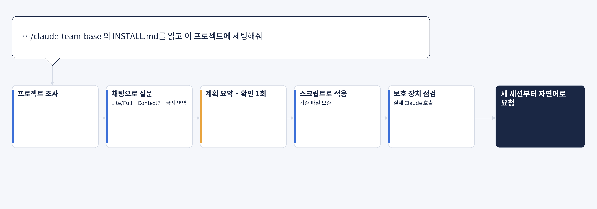
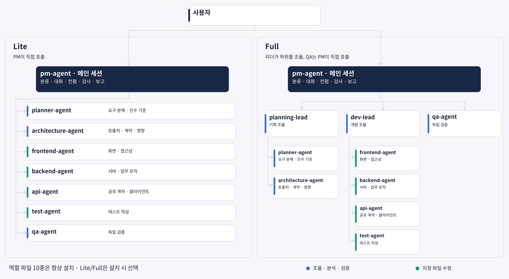
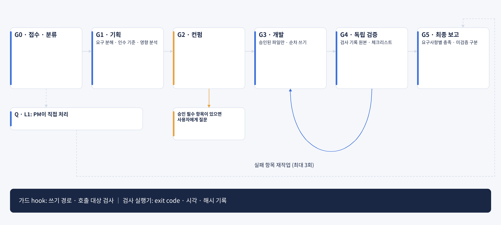

<h1 align="center">claude-team-base</h1>

<p align="center">
  
</p>

<p align="center">
  <a href="https://github.com/jbeat30/claude-team-base/actions/workflows/ci.yml"></a>
  
  
  
  <a href="LICENSE"></a>
</p>

<p align="center"><a href="README.en.md">English</a></p>

기존 프로젝트의 규칙과 도구를 존중하면서, 메인 세션 PM·담당 에이전트·독립 QA가 단계 게이트로 일하는 Claude Code 에이전트 팀
속도보다 요구 충족·누락 발견·범위 통제·근거·마무리 완성도를 우선

> **v0.1.0 실험적 공개 준비 중** · 현재 설치 가능한 릴리즈 태그 없음
> 아래 빠른 시작은 릴리즈 후 사용 절차. 태그가 없으면 INSTALL.md에 따라 설치 중단
> 설계와 동작 확인 범위는 [현재 상태](#현재-상태)에 정리
> 성능·품질 향상은 평가로 입증하기 전까지 주장하지 않음

## 빠른 시작

내 프로젝트에서 Claude Code를 열고 한 줄만 요청

```text
https://github.com/jbeat30/claude-team-base 의 INSTALL.md를 읽고 이 프로젝트에 세팅해줘
```



- Claude가 [INSTALL.md](INSTALL.md)를 읽고 릴리즈 태그로 고정해 가져온 뒤 프로젝트를 조사
- 채팅에서 필요한 것만 질문: Lite/Full, Context7 MCP 등록, 수정 금지 영역, 감지 결과 확인
- 변경 계획을 10줄 이내로 보여주고 **설치 계획의 최종 확인은 한 번**(불확실한 정보·충돌·실패 처리는 별도 질문 가능)
- 설치 스크립트가 복사·병합을 결정적으로 수행하고 보호 장치를 실제 Claude 호출로 점검
- 요구 사항: Claude Code 2.1.302 이상, Node 18 이상
- 기존 파일은 덮어쓰지 않고 전역 설정·기능 코드는 변경하지 않음, 언제든 제거 가능

설치 후에는 새 세션부터 자연어로 요청

```text
기존 로그인 화면에 비밀번호 표시 전환을 추가해줘. 현재 UI 규칙을 따라줘.
```

```text
주문 API 응답에 배송 상태를 추가하고 화면에 연결해줘. 계약과 영향 범위부터 정리해줘.
```

```text
이 함수가 어떤 역할인지 설명해줘.
```

## 동작 방식

### 에이전트 팀



메인 세션이 PM(`pm-agent`)으로 동작하며 사용자와 대화하고, 필요한 역할만 호출
역할 파일 10종은 항상 전부 설치하고 **Lite/Full은 설치할 때 고르는 사용 모드**

| 모드 | 구성 | 적합한 경우 |
| --- | --- | --- |
| Lite | PM이 분석·실무·QA를 직접 호출 | 일반 작업 |
| Full | 기획 리더·개발 리더가 하위 역할을 조율, QA는 PM이 직접 호출 | 다영역·대형·고위험 작업 |

| 역할 | 담당 |
| --- | --- |
| pm-agent (메인 세션) | 요청 분류, 사용자 대화·확인, 승인 범위 관리, 검사 실행, 최종 보고 |
| planning-lead · dev-lead | Full에서 기획 조율 · 개발 조율 |
| planner-agent | 요구 분해, 사용자가 놓칠 수 있는 항목 발굴, 인수 기준 |
| architecture-agent | 호출처·계약·회귀·사이드이펙트 분석 |
| frontend · backend · api · test | 배정된 파일만 수정, 테스트 작성 |
| qa-agent | 기획 검증, 변경·검사 기록·완료 체크리스트의 독립 검증 |

### 작업 흐름



| 등급 | 예 | 경로 |
| --- | --- | --- |
| Q | 질문·설명 | PM이 직접 답변 |
| L1 | 주석·오탈자·문구, 동작 불변 | PM이 직접 수정하고 완료 확인 |
| L2 | 동작이 바뀌는 일반 변경 | 기획 → 컨펌 → 개발 → 최종 검증 |
| L3 | 계약·권한·데이터·보안·다수 영역 | L2 경로에 영향 분석 필수, 사용자 확인 필수 |

- **요구는 Given/When/Then 인수 기준으로 정리**하고, 테스트가 가능하면 실패 테스트를 먼저 작성
- **요청 원문과 기획안 파일을 모든 에이전트가 직접 읽음**, 요약 전달로 요구가 변형되는 것을 방지
- 요구 범위 변경·정책 결정·호환성 변경·보안·외부 영향이 있으면 사용자에게 먼저 확인, 없으면 PM이 자체 컨펌하고 표시
- 컨펌 전에는 소스를 수정하지 않음, 검증 실패는 개발로 돌아가 보완하며 재작업 한도 3회
- 검사는 승인된 명령만 **검사 실행기**가 실행해 exit code·시각·출력·해시를 기록하고, QA는 PM의 요약이 아닌 이 원본을 확인
- 라이브러리·프레임워크 동작은 설치된 버전 기준으로 Context7에서 확인하고, 확인하지 못한 내용은 `미확인`으로 표시

## 설치되는 것

```text
.claude/
  agents/        역할 정의 10종
  hooks/         가드 hook
  team/          양식, 프로젝트 프로필, 검사 실행기, 설치 매니페스트
  settings.json  agent=pm-agent와 hook 등록(기존 설정과 병합)
.claude-team-docs/   작업별 기록(요청 원문·기획안·보고·검사 기록·diff), .gitignore 추가 선택
.mcp.json            Context7 등록(선택, 기존 설정과 병합)
```

## 안전장치와 한계

- **가드 hook(권고 모드)**: 역할별 쓰기 경로, 기획안이 확정된 뒤에만 소스 쓰기, 배정된 파일만 수정, 리더의 호출 대상 제한, 쓰기 에이전트의 순차 실행을 검사하고 오류 시 차단
- **실수 방지 장치이며 보안 경계가 아님**: 메인 세션의 셸 명령과 사용자·hook 설정 변경은 막지 않음
- 검사 기록은 메인 세션이 실행기로 실행한 결과이며 위·변조를 완전히 방어하지 않음, QA 보고서에 출처를 표기
- 설치 직후 보호 장치를 실제 Claude 호출로 점검하고, 확인되지 않으면 `보호 없음`으로 취급
- 취약점은 [SECURITY.md](SECURITY.md)로 비공개 제보

## 현재 상태

| 구분 | 내용 |
| --- | --- |
| 기존 확인 기록 | 임시 프로젝트에서 Claude Code 2.1.302(Windows, 비대화형)로 Lite·Full 흐름, 가드 hook 발화·차단, 설치·검증·제거. 대화형 수동 점검과 구분 |
| 자동 검사 | [PR #4 CI](https://github.com/jbeat30/claude-team-base/actions/runs/39152624814)의 `09b6136` 기준 정적 검사·단위 31건, Ubuntu·Windows(Node 20) 통과. 해당 수정은 feature 통합 기준에 반영, README 브랜치도 로컬 Windows(Node 24)에서 31건 통과 |
| 추가 로컬 검사 | 엄격 모드·설치 대상 경로 수정 포함 Windows(Node 24) 자동 검사 47건 통과, 새 변경의 원격 CI는 대기 |
| 미확인 | 대화형 세션의 승인 흐름·workspace trust, Windows 외 OS의 실제 Claude 실행, 반복 평가(성능·위임 정확도), Context7 연동 실사용, 최종 통합본의 Q·L1·L2·L3 대화형 수동 시나리오, 최소 Node 18에서의 실행 |
| 추가 구현·검증 중 | 엄격 모드의 직접 승인·등록·해시 검사 구현, 자동 회귀 검사와 실제 대화형 검증은 구분. [절차와 한계](template/.claude/team/strict-mode.md) |
| v0.1.0 남은 작업 | relay 모드, 실제 환경 검증과 반복 행동 평가 |
| v0.2.0 예정 | bkit PDCA standalone·integrated 연동. v0.1.0 설치는 off만 허용하며 팀 자체 기획·검증 게이트는 유지 |

### 공개 전 수동 점검

최종 통합 커밋을 새 임시 프로젝트에 설치한 뒤 Q·L1·L2·L3를 각 1건 이상 확인

| 시나리오 | 확인할 결과 |
| --- | --- |
| Q · 함수 설명 | 파일 변경·위임·PDCA 없이 답변 |
| L1 · 단일 파일 오탈자 | 메인 직접 수정, 해당 파일만 변경, 경량 완료 확인 |
| L2 · 일반 동작 변경 | 기획 → 컨펌 → 개발 → 독립 QA, 검사 원본·diff와 보고 일치 |
| L3 · API 계약 변경 | 영향 분석과 사용자 확인 전 소스 변경 없음, 확인 후 게이트·검증 완료 |

Lite·Full 양쪽의 L2·L3 호출 경로를 확인하고, 승인 거절·가드 차단·검사 실패·기존 설정 보존·제거도 별도 확인
커밋·환경·프로파일·요청·승인 내역·도구 호출·diff·검사 기록을 남기며, 4건 성공만으로 모든 환경의 안전성을 보장하지 않음
미점검 항목은 미확인으로 유지하고, 확인 없이 소스를 바꾸거나 범위 밖 쓰기가 허용되는 실패는 해결 전 공개 보류

## 제거와 갱신

설치할 때와 같이 Claude에게 요청, 설치 매니페스트에 기록된 태그로 설치 스크립트를 다시 가져와 처리

```text
https://github.com/jbeat30/claude-team-base 의 INSTALL.md를 읽고 이 프로젝트에서 제거해줘
```

```text
https://github.com/jbeat30/claude-team-base 의 INSTALL.md를 읽고 이 프로젝트를 최신 버전으로 갱신해줘
```

- 제거: 미리보기를 보여주고 확인 후 설치한 항목만 되돌림, 설치 후 사용자가 수정한 파일은 보존, 작업 기록(`.claude-team-docs`)과 백업은 삭제하지 않음
- 갱신: 새 태그와 설치본의 차이를 계획으로 확인한 뒤 적용, 사용자가 수정한 파일은 자동으로 덮어쓰지 않고 충돌로 알림

## 기여

이슈와 포크 PR을 환영, 저장소 쓰기 권한은 소유자만 보유하며 모든 변경은 소유자가 검토·승인한 뒤 머지

- 문제 제보·기능 제안: [Issues](https://github.com/jbeat30/claude-team-base/issues/new/choose)
- 변경 제안: 포크 후 PR, 대상은 소유자가 지정한 `feature/vX.Y.Z`
- `main`·`release`·`feature`는 PR 필수·강제 푸시 금지, 외부 기여자의 직접 푸시·머지 불가
- 외부 기여자의 fork PR 워크플로는 기여 이력과 관계없이 소유자 실행 승인 필요
- 개발 환경은 Node 18 이상, `npm test`로 정적 검사와 단위 테스트 실행
- 자세한 규칙: [기여 안내](.github/CONTRIBUTING.md) · [브랜치 전략](.github/BRANCH_STRATEGY.md) · [개발 규칙](AGENTS.md)

## 라이선스

[MIT](LICENSE) · Copyright (c) 2026 jbeat
